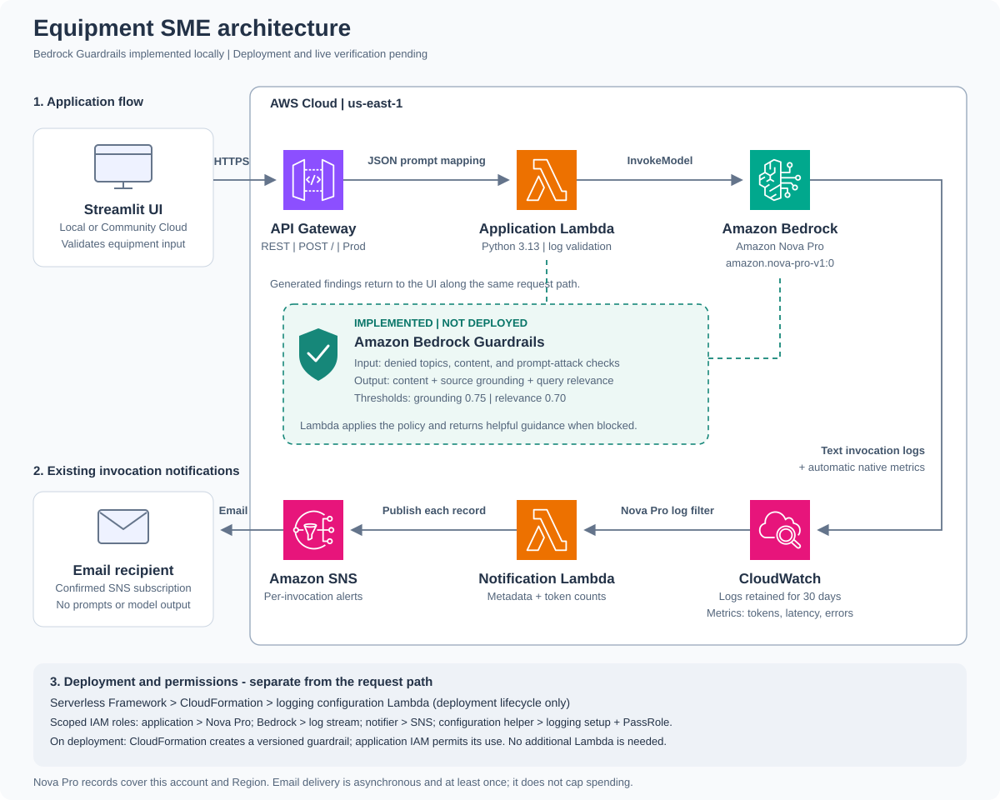

# Equipment SME

## 1. What the app does

- Summarizes wind turbine equipment logs into **up to five findings**.
- Uses **Amazon Nova Pro** (`amazon.nova-pro-v1:0`) through Amazon Bedrock.
- Provides a Streamlit interface for entering logs and viewing results.
- Shows an example log to help users enter useful information.
- Rejects input that is too short to describe a meaningful equipment condition before calling the model.
- Instructs the model to decline unrelated text and use only facts from the logs.

## 2. How it works



- **Top row:** Application request and response flow.
- **Middle row:** Bedrock logs flow right to left through CloudWatch, the notifier, SNS, and email.
- **Bottom panel:** Infrastructure deployment and scoped IAM permissions.
- [Open the full-size architecture diagram](./architecture.svg).

1. The user enters equipment logs in the Streamlit app.
2. Streamlit sends the logs to Amazon API Gateway.
3. API Gateway passes the prompt to AWS Lambda.
4. Lambda sends the prompt to Amazon Bedrock.
5. Bedrock generates the findings.
6. Streamlit displays the results.

- Bedrock also sends invocation logs to CloudWatch Logs.
- Bedrock publishes usage and performance metrics to CloudWatch automatically.

- **Frontend:** Streamlit, running locally or on Streamlit Community Cloud.
- **Backend:** API Gateway, Python 3.13 Lambda, and Amazon Bedrock.
- **Infrastructure:** Defined in `serverless.yml` using Serverless Framework v4.

## 3. What you need

### To run the frontend locally

- Git.
- Python 3.13, or another Python version supported by Streamlit.
- The URL of a deployed backend API.
- A terminal using **Windows PowerShell** for the commands below.

### To deploy your own AWS backend

- An AWS account and a configured AWS CLI profile.
- AWS CLI v2.
- Node.js 22 LTS and npm.
- Serverless Framework v4 and a Serverless account.
- AWS deployment permissions and Nova Pro model access in `us-east-1`.
- An email address for SNS invocation notifications; confirmation is required.

## 4. Clone and run locally

- Run the following steps in order.
- If you do not have a backend URL, complete section 5 before step 4 below.

### Step 1: Clone the repository

```powershell
git clone https://github.com/rohitjain2021/Equipment_SME.git
cd Equipment_SME
```

### Step 2: Create a Python environment

```powershell
python -m venv .venv
```

### Step 3: Install the packages

```powershell
.\.venv\Scripts\python.exe -m pip install --upgrade pip
.\.venv\Scripts\python.exe -m pip install -r .\Streamlit_UI\requirements.txt
```

- Use this environment's Python for all local app commands.
- You do not need to activate the environment separately.

### Step 4: Set the backend URL

```powershell
$env:SME_API_URL = 'https://<API_ID>.execute-api.us-east-1.amazonaws.com/Prod/'
```

- Replace `<API_ID>` with the API ID from your deployment.
- Use the full URL ending in `/Prod/`.
- Set this variable again whenever you open a new terminal.
- No AWS credentials are needed by the frontend for the current API.

### Step 5: Start the app

```powershell
.\.venv\Scripts\python.exe -m streamlit run .\Streamlit_UI\streamlit_app.py
```

1. Open **http://localhost:8501**.
2. Enter equipment logs, using the displayed example as a guide.
3. Select **Summarize**.
4. Review the findings.
5. Press `Ctrl+C` in the terminal to stop the server.

- Start the app with `python -m streamlit run`, not `python streamlit_app.py`.
- Local startup still uses the AWS backend for each analysis.

## 5. Deploy the AWS backend

- Skip this section if you already have a working backend URL.
- Run these commands from the project root.
- Use an existing AWS profile, or configure one locally before continuing.
- See the [setup guide](./SETUP_GUIDE.md#4-get-a-backend-url-or-deploy-your-own)
  for AWS profile setup and required permissions.

### Step 1: Install Serverless Framework

```powershell
npm install --global serverless@4
```

### Step 2: Sign in and verify your AWS identity

```powershell
$env:ALERT_EMAIL = Read-Host 'Email address for Bedrock invocation notifications'
serverless login
aws sts get-caller-identity --profile default
```

- Complete the browser sign-in and wait for confirmation in the terminal.
- Check that the AWS command shows the intended account.
- Replace `default` in every command if you use a different profile.
- Set `ALERT_EMAIL` before each deployment, or supply `--param="alertEmail=<EMAIL>"`.
- Keep the real email private; it is passed through a CloudFormation `NoEcho` parameter.
- No recipient address is hardcoded in the application or infrastructure templates.
- For CI/CD, supply `ALERT_EMAIL` through the pipeline's secret store.
- Generated deployment files can contain the resolved email; `.serverless/` stays out of Git.

### Step 3: Review, package, and deploy

```powershell
serverless print --stage Prod --aws-profile default
serverless package --stage Prod --aws-profile default
serverless deploy --stage Prod --aws-profile default
serverless info --stage Prod --aws-profile default
```

- The first deployment creates stack **`equipment-sme-Prod`** in **`us-east-1`**.
- Later deployments update the same stack.
- Manually created AWS resources are not automatically imported.
- The deployment output includes the backend API URL.
- Use that URL in section 4, step 4, or in the Community Cloud settings below.
- This command deploys the backend; frontend hosting is configured separately.
- It also creates and configures the Bedrock logging infrastructure described in section 10.

## 6. Publish the frontend on Streamlit Community Cloud

1. Commit and push the frontend and `Streamlit_UI/requirements.txt` to GitHub.
2. Sign in to [Streamlit Community Cloud](https://share.streamlit.io/).
3. Select **Create app** and choose the existing GitHub app option.
4. Set the repository to `rohitjain2021/Equipment_SME`.
5. Select branch `main` and main file `Streamlit_UI/streamlit_app.py`.
6. Choose an available app subdomain, or accept the generated one.
7. Open **Advanced settings** and select Python **3.13**.
8. Add the following root-level value under **Secrets**, using your real API ID:

```toml
SME_API_URL = "https://<API_ID>.execute-api.us-east-1.amazonaws.com/Prod/"
```

9. Save the settings and deploy.
10. Open the generated `https://<app-name>.streamlit.app` URL.
11. Test with valid logs and with invalid input before sharing the app.

- Keep `SME_API_URL` outside any TOML section such as `[settings]`.
- Community Cloud installs the frontend packages and starts the server.
- The backend continues running in AWS.
- Push frontend updates to the selected GitHub branch to update the hosted app.
- Follow [section 7 of the setup guide](./SETUP_GUIDE.md#7-host-the-frontend-on-streamlit-community-cloud)
  for detailed publishing steps.

## 7. Run the regression tests

```powershell
python -m unittest discover -s tests -v
```

- Run from the project root.
- Tests check input validation, response handling, and model request settings.
- Tests also check Bedrock logging setup, updates, and safe cleanup.
- Tests use mocks and do not make AWS calls.

## 8. Main project files

- `Streamlit_UI/streamlit_app.py`: Streamlit frontend.
- `Streamlit_UI/requirements.txt`: Frontend Python packages.
- `lambda_function.py`: Input validation and Bedrock model calls.
- `serverless.yml`: AWS infrastructure and runtime permissions.
- `infrastructure/bedrock-logging.yml`: Bedrock log group, roles, and automatic configuration.
- `infrastructure/bedrock_logging.py`: Stack lifecycle helper for Bedrock logging.
- `infrastructure/bedrock-alerts.yml`: SNS topic, email subscription, and log subscription.
- `infrastructure/bedrock_notifications.py`: Sends metadata-only notifications for recorded model calls.
- `architecture.svg`: Architecture diagram.
- `tests/`: Regression tests.
- [SETUP_GUIDE.md](./SETUP_GUIDE.md): Detailed setup commands and common errors.

## 9. Security and usage notes

- Keep AWS credentials and Serverless tokens out of code, Git, and documentation.
- Enter the live backend URL through an environment variable or hosted app secrets.
- Keep local `.streamlit/secrets.toml` files private; they are excluded from Git.
- Generated `.serverless` files and virtual environments are excluded from Git.
- The current API has no authentication; anyone with its URL can call it.
- Add API authentication to limit access to approved users.
- AWS requests incur usage charges, including requests made through a local UI.
- API Gateway waits up to 29 seconds, while Lambda can run for 123 seconds.
- Review generated findings against the original logs; model instructions do not
  guarantee factual accuracy.

## 10. Bedrock observability

### What we want to understand

- Which model requests were made and what responses they produced.
- How many input and output tokens the model used.
- How model request volume, response time, and errors change over time.

### What we added

- **CloudWatch log group:** `/aws/bedrock/equipment-sme-Prod`, with 30-day retention.
- **Bedrock delivery role:** Allows Bedrock to write only to its destination log stream.
- **Configuration helper:** A separate Lambda that enables logging during stack deployment.
- **Helper IAM role:** Allows configuration changes and passing the dedicated delivery role.
- **CloudFormation custom resource:** Runs the helper on stack creation, updates, and deletion.
- **Regression tests:** Check ownership protection, configuration updates, and cleanup.
- **Architecture diagram:** Shows the Bedrock-to-CloudWatch connection.

### What has been completed

1. Deployed the logging infrastructure into the existing `equipment-sme-Prod` stack.
2. Confirmed CloudFormation reached `UPDATE_COMPLETE`.
3. Confirmed text invocation logging is enabled without a manual console setup step.
4. Sent a synthetic equipment log through the API.
5. Verified the Bedrock invocation record arrived in CloudWatch with token counts.
6. Confirmed native invocation, token, and latency metrics are available.
7. Passed all 20 regression tests, including invocation notification checks.

### How to view logs and metrics

1. For a new environment, deploy the stack using section 5; the current environment is already configured.
2. Submit a synthetic equipment log through the app.
3. Open **CloudWatch > Log groups** in `us-east-1`.
4. Select `/aws/bedrock/equipment-sme-Prod` and inspect the invocation records.
5. For native metrics, open **CloudWatch > Metrics > AWS/Bedrock** and select Nova Pro.

### Scope and data handling

- Text invocation logging is enabled automatically through the stack.
- Invocation records include model inputs and outputs; restrict access to these logs.
- Logging applies to supported text-model invocations across the account in this Region.
- Logs expire after 30 days; the log group is retained when the stack is deleted.
- Native token, latency, error, and invocation metrics are published independently of logging.
- The configuration helper refuses to overwrite another logging destination.
- Image, audio, video, embedding logging, and S3 delivery are disabled in this configuration.
- Dashboards, threshold alarms, and custom application metrics are not included.

## 11. Bedrock invocation email notifications

1. Set `ALERT_EMAIL` privately and deploy using section 5.
2. Open the SNS confirmation email and select **Confirm subscription**.
3. Submit a valid equipment log through the app.
4. After Bedrock delivers its log record, the notifier publishes a message to SNS.
5. Check your email for the request ID, timestamp, model, and token counts.

- A CloudWatch Logs subscription selects Nova Pro invocation records.
- A dedicated notifier Lambda publishes one message per matching record to SNS.
- Emails contain no equipment logs, prompts, model responses, or caller identities.
- Notifications cover recorded Nova Pro calls in the regional Bedrock log group,
  including calls from other applications using this model.
- This is a per-invocation notification, not a threshold alarm or spending limit.
- Notification delivery can be delayed and retries can produce duplicates.
- Unconfirmed email subscriptions do not receive invocation notifications.
- `NoEcho` masks the stack parameter; authorized SNS users can still view the subscription address.
- SNS publishes, notifier execution, and log processing incur usage charges.
